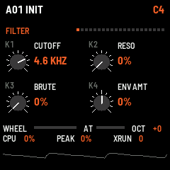

# MB-1 manual

MB-1 turns the FM-1 into a monophonic Minibrute-style synthesizer. One voice, last-note priority: hold a key, play
another, let it go, and the first comes back (with glide, if GLIDE is up).

## The screen

At the top: the patch slot and its name (a `*` when it has changed since it was saved) and the note playing. In the
middle: the page, and its four parameters, one for each of K1..K4, with their values and bars. At the bottom: the mod
wheel, the keys' pressure (aftertouch), the octave, the audio load (CPU: now, PEAK: the most since power-on, in % of the time the FM-1 has for each block of sound; XRUN: blocks it missed, heard as clicks), and the sound as a scope.

## The controls

| Control | What it does |
| --- | --- |
| K1..K4 | The four parameters on screen. A fast turn moves in bigger steps. |
| HOME, SEL, ENV, LFO, EDIT, GLO, FX | A page; pressed again, its second page (the button of the page on screen is lit) |
| SELECT | Steps through every page |
| ALGO | The mod wheel (sent as MIDI CC 1 too). Where it goes: PERFORM, WHEEL TO |
| PRESET | The patch slot, 1..32. Turning it loads the slot (unsaved changes are dropped) |
| SAVE | Stores the patch in its slot, and the settings (lit when there is something to save) |
| OCT- / OCT+ | The keyboard's octave, -2..+2 |
| ARP | The arpeggiator: OFF, ON, HOLD in turn (and its page). Held half a second: its pages, ARP and ARP 2. Lit while it runs, dark a moment on each beat |
| PLAY | Tap tempo: tap it on the beat |
| The keys | Notes with velocity; pressing harder is aftertouch |

## The pages

| Page | Button | K1 | K2 | K3 | K4 |
| --- | --- | --- | --- | --- | --- |
| FILTER | HOME | CUTOFF | RESO | BRUTE | ENV AMT |
| FILTER 2 | HOME | MODE | KBD TRK | ENV VEL | AMP VEL |
| OSC | SEL | SAW | SQUARE | TRI | SUB |
| OSC 2 | SEL | NOISE | ULTRASAW | PW | METAL |
| FILT ENV | ENV | ATTACK | DECAY | SUSTAIN | RELEASE |
| AMP ENV | ENV | ATTACK | DECAY | SUSTAIN | RELEASE |
| LFO | LFO | RATE | WAVE | PITCH | FILTER |
| LFO 2 | LFO | PWM/MTL | AMP | VIB RATE | VIB TYPE |
| PERFORM | EDIT | GLIDE | VINTAGE | WHEEL TO | WHL AMT |
| MORE | GLO | SUB OCT | SUB WAVE | US RATE | LEVEL |
| VOICE | GLO | PLAY | BEND | LFO RTRG |  |
| TOUCH | FX | AT VIB | AT CUT | PW ENV | MTL ENV |
| ARP | ARP | MODE | OCTAVE | STEP | SWING |
| ARP 2 | ARP (held) | TEMPO | ARP | HOLD ORD | LFO CLK |

Notes on a few of them:

- **ULTRASAW** (OSC 2) adds two shifting copies of the sawtooth, as the hardware does: one moved by a slow LFO of its
  own, one by **US RATE** (MORE).
- **METAL** (OSC 2) folds the triangle through four folding stages (low settings fold only its top); **MTL ENV** and
  **PWM/MTL** move it with the filter envelope and the LFO.
- **BRUTE** (FILTER) feeds the sound after the VCA back into the oscillator mixer, as the hardware does: growl, then,
  near full, chaos (a low growl a third of the note's pitch). It follows the amp envelope.
- **MODE** (FILTER 2): LP, BP, HP and NOTCH as the Minibrute's Steiner-Parker filter makes them: HP keeps some low
  end, the notch is shallow.
- **WHEEL TO** (PERFORM) is the Minibrute's mod wheel destination: LFO AMT, VIBRATO or CUTOFF; **WHL AMT** how far.
- **VINTAGE** (PERFORM) detunes each note a little, the way an old oscillator drifts.
- **PLAY** (VOICE): LEGATO, a note played while another is held keeps the envelopes going (and glides); RETRIG, every
  note restarts them. **BEND** is the pitch bend's range, 1..12 semitones. **LFO RTRG** restarts the LFO with each
  note that starts the envelopes.

## The arpeggiator

After the Minibrute's. ARP steps through OFF, ON and HOLD:

- **ON** plays the keys while you hold them.
- **HOLD** keeps playing the last chord when you let go; a key pressed with none held starts a new one. With
  **HOLD ORD** PLAYED (ARP 2), the notes play in the order you pressed them, up to 16, a note as often as you
  play it: hold the first key down and tap the others (C held, then E, D, E: C E D E); with PITCH, a chord, low to
  high.
- **MODE**: UP, DOWN, UP/DOWN (the top and bottom notes play twice, as on the Minibrute) or RANDOM.
- **OCTAVE**: over 1 to 4 octaves.
- **STEP**: 1/4, 1/8, 1/16, or their triplets 1/4T, 1/8T, 1/16T.
- **SWING**: 50 % (straight) to 75 % in six steps: every second note comes later.
- **TEMPO** (ARP 2): 30 to 260 BPM; or tap PLAY on the beat. When MIDI clock comes in (USB, Bluetooth or TRS),
  the arpeggiator follows it, and TEMPO at its lowest halves it, at its highest doubles it.
- **LFO CLK** (ARP 2): ARP puts the LFO on the arpeggiator's tempo; LFO RATE then picks a note value (8 bars
  dotted .. a 64th triplet), as the plugin's synced LFO.

Each note sounds for half its step. As in the plugin, the arpeggiator is the patch's: ARP (OFF, ON or HOLD), MODE,
OCTAVE, STEP and SWING are saved with it, so picking a patch can switch the arpeggiator on. TEMPO, HOLD ORD and
LFO CLK belong to the instrument (one tempo for every patch).

## The patches

Slots 1..8 start with factory sounds: INIT, BASS, ACID, METALEAD, ULTRAPAD, PERC, BRASS, WOBBLE. Slots 9..32 start as
INIT. SAVE writes over the slot shown.

## The knobs' range

Every knob runs over the same range, with the same feel, as the MiniBrute V plugin's: the cutoff from 20 Hz to 20 kHz,
the attacks to 12.5 s, the decays and releases to 25 s, KBD TRK to 200 %, GLIDE to 2 s an octave, the LFO from
0.05 to 100 Hz, VIB RATE from 1 to 50 Hz, US RATE from 0.005 to 43 Hz. A knob at the same place as the plugin's
knob is the same setting.

## Loading patches from a computer

MB-1 takes patches over USB MIDI SysEx (`F0 7D 4D 42 ...`, app/app.c "the loader"): a patch into a slot, the
slots stored, a slot played, the factory patches back. Each frame is answered.

MB-1 plays from USB, Bluetooth and TRS MIDI on any channel: notes, pitch bend (VOICE: BEND, 1..12 semitones), the mod wheel (CC 1),
aftertouch (channel or poly), all notes off (CC 120, 123), and every parameter by its CC. The keys and the knobs are
sent out over USB and Bluetooth.

| CC | Parameter | Page |
| --- | --- | --- |
| 74 | CUTOFF | FILTER |
| 71 | RESO | FILTER |
| 20 | BRUTE | FILTER |
| 21 | ENV AMT | FILTER |
| 22 | MODE | FILTER 2 |
| 23 | KBD TRK | FILTER 2 |
| 24 | ENV VEL | FILTER 2 |
| 25 | AMP VEL | FILTER 2 |
| 26 | SAW | OSC |
| 27 | SQUARE | OSC |
| 28 | TRI | OSC |
| 29 | SUB | OSC |
| 30 | NOISE | OSC 2 |
| 31 | ULTRASAW | OSC 2 |
| 75 | PW | OSC 2 |
| 76 | METAL | OSC 2 |
| 77 | ATTACK | FILT ENV |
| 78 | DECAY | FILT ENV |
| 79 | SUSTAIN | FILT ENV |
| 80 | RELEASE | FILT ENV |
| 73 | ATTACK | AMP ENV |
| 81 | DECAY | AMP ENV |
| 82 | SUSTAIN | AMP ENV |
| 72 | RELEASE | AMP ENV |
| 83 | RATE | LFO |
| 84 | WAVE | LFO |
| 85 | PITCH | LFO |
| 86 | FILTER | LFO |
| 87 | PWM/MTL | LFO 2 |
| 88 | AMP | LFO 2 |
| 89 | VIB RATE | LFO 2 |
| 90 | VIB TYPE | LFO 2 |
| 5 | GLIDE | PERFORM |
| 91 | VINTAGE | PERFORM |
| 92 | WHEEL TO | PERFORM |
| 93 | WHL AMT | PERFORM |
| 94 | SUB OCT | MORE |
| 95 | SUB WAVE | MORE |
| 96 | US RATE | MORE |
| 7 | LEVEL | MORE |
| 102 | PLAY | VOICE |
| 103 | BEND | VOICE |
| 104 | LFO RTRG | VOICE |
| 105 | ARP (off, on, hold) | ARP 2 |
| 106 | MODE | ARP |
| 107 | OCTAVE | ARP |
| 108 | STEP | ARP |
| 109 | SWING | ARP |
| 97 | AT VIB | TOUCH |
| 98 | AT CUT | TOUCH |
| 99 | PW ENV | TOUCH |
| 100 | MTL ENV | TOUCH |

Choices (MODE, WAVE, ...) take the CC range in equal parts.
